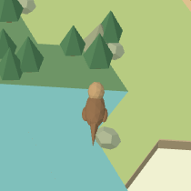
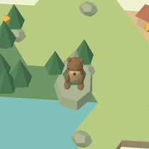
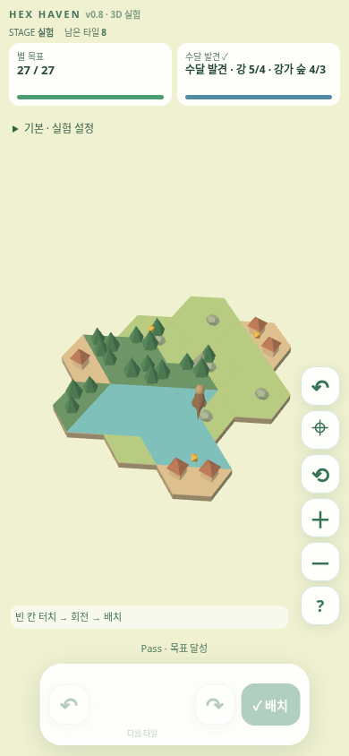
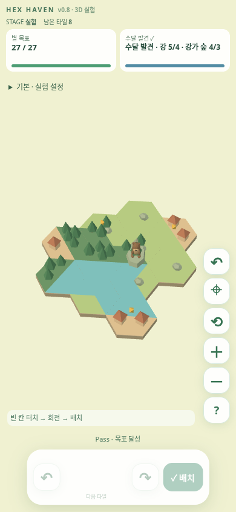

# v0.8 팬 방향·앉은 수달 개선

기준: PR #4의 1ee621d. main과 PR #3는 수정하지 않는다. 이번 패치는 우클릭 이동과 수달 표현에 집중한다.

## 원인과 수정
- 기존 팬은 거리 기반 근사 배율과 월드 축 삼각함수로 계산했다. 상하 부호가 화면 방향과 반대였고 첫 8px 이내 이동도 빠졌다.
- 이전/현재 화면 좌표를 같은 보드 평면에 Raycaster로 투영하고 그 차이만큼 카메라 target을 이동한다.
  따라서 실제로 집은 보드 지점이 포인터를 따른다. 좌클릭 360도 회전은 같은 방식으로 유지한다.
- 우클릭은 이동 전용이며 정지 우클릭으로 타일을 선택하지 않는다. 핀치/두 손가락 이동도 같은 화면 좌표 원리를 사용한다.
- 이전 수달은 수평 몸통과 전신의 Y축 부유 때문에 얼굴이 물에 잠긴 것처럼 보였다.
- 돌의 바닥을 보드 표면 y=.12에 놓고, 수달을 돌 위에 앉혔다. 발은 돌 상단과 접촉하고 머리는 몸 위에 둔다.
- 위치는 발견된 강에 실제로 접한 숲/혼합 타일에서 선택하고 얼굴 방향을 물 쪽으로 맞춘다.
- 고개 좌우 회전 ±.16rad, 작은 고개 기울기 ±.025rad, 꼬리 회전 ±.1rad만 적용한다. 몸/발은 상하 이동하지 않는다.
- 발견 조건·별·모드·덱·undo·저장 코드는 바꾸지 않는다. 추가 보상과 새 생태 조건은 없다.

## 검증
- 기존 35개 + 새 3개 = 자동 테스트 38개. 모든 각도/기울기/확대 조합의 평면 팬, 돌 접지, 머리/꼬리 애니메이션 및 강가 위치를 검증한다.
- Chromium 실제 마우스: 좌클릭으로 0/+110/-210px 회전한 각각의 카메라 상태에서 우클릭으로 좌우 50px, 상하 45px 이동한다.
  수정 전 위쪽 -45px 드래그에 보드가 아래쪽 약 +33.5px 이동했다. 수정 후 12개 제스처에서 드래그와 보드 지점 이동이 일치한다(오차 .1px 미만).
- 실제 브라우저에서 수달 루트 y=.12 고정, 시간에 따른 머리/꼬리 각도 변화, 동작 줄이기 시 중립 복귀를 확인한다.
- PC 1280x800 및 터치 에뮬레이션 390x844에서 동일 시드 202607의 기존 Pass 경로로 전후 촬영한다.
- scripts/test-browser-v08.py의 기존 배치/회전/핀치/저장/undo/컨텍스트 복원 검증도 유지한다.
- 새 명령: python scripts/test-v08-pan-otter.py --root . --output /tmp/v08-after --assert-fixed
- 원시 결과: V08_PAN_OTTER_RESULTS.json. 실제 iPhone Safari 실기기 검증은 미완료다.

## 전후 이미지
동일 시드·같은 보드·같은 기본 카메라·동작 줄이기 상태에서 촬영했다.

| | 수정 전 | 수정 후 |
|---|---|---|
| 수달 확대 |  |  |
| 모바일 전체 |  |  |
